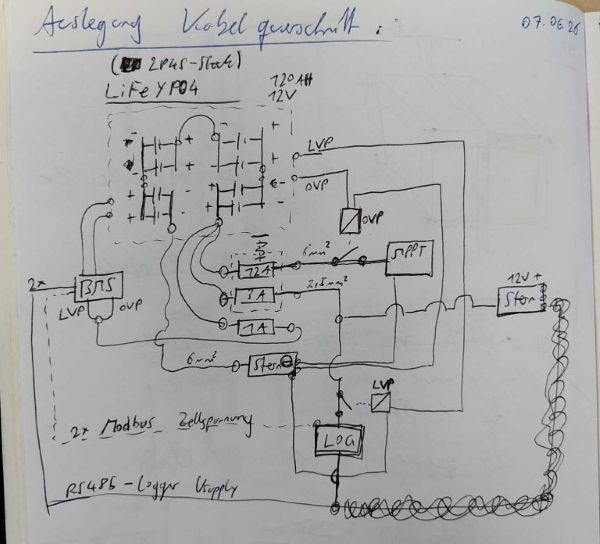
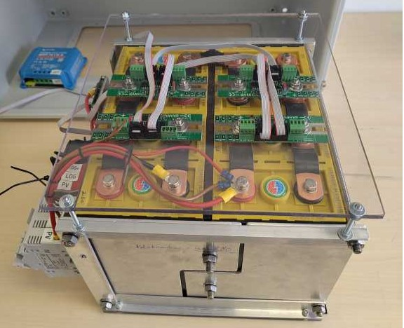
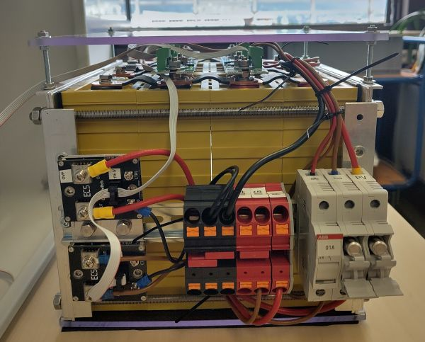
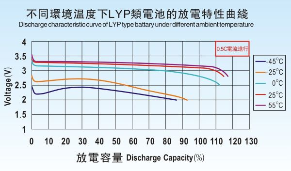
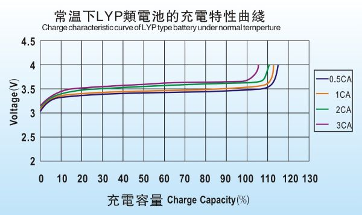
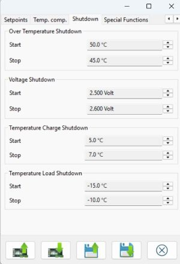

# 2p4s Stack mit LiFeYPo4-Zellen

### Spezifikation
 - Kapazität 120 AH
 - Konfiguration 2p4s
 - Temperturbereich -40°C bis 80°C
 

### Konzept 

### BMS

### Verkabelung 

# Konfiguration BMS und MPPT

## LYP 60AHA Zellen-Spezifikation laut Datenblatt
Nennkapazität Zelle:            60AH / 195Wh  

Kapazität 2p4s stack:           120AH / 1560Wh

Kapazität 2p4s @ 80% DOD:       1248Wh

Nennspannung Zelle (Diagramm):  ~3,25V

Initialladung Distributor:      3,55V

Betriebstemperatur: -45°C bis 85°C

Max. Ladespannung: 4V (2p4S = 16V)

Min. Entladespannung: 2,7V (2P4S = 10,8V)

Schadensgrenze Endladespannung: 2V bis 2,5V (2P4S = 8V bis 10V)

Betriebsspannung: 2,8V bis 4V (2P4S = 11,2V bis 16V)

## lipro 1.1 V3 Werkseinstellung

Default Balanver Voltage: 3,6V

OVP Alarm: 3,7V (2p4s = 14,8V)

LVP Alarm: 2,8V (sp4S = 11,2V)

OVP Trig: 3,65V (14,6V)

OVP Clear: 3,6V (14,4V)

UVP Trig: 2,9V (11,6V)

UVP Clear: 3,2V (12,8V)

UVP Clear Delay: 10min

OVP 2p4s = 14,6V

UVP 2p4s = 11,6V

lipro Betriebsspannungsbereich: 11,6V bis 14,6V

lipro Betriebsspannungsbereich Balancer inaktiv: 11,6V bis 14,4V

## MPPT Ladekonfiguration  

Ladeschlussspannung < OVP

Ausgleichsspannung für Blei/Säure deaktiviert

3 Stufen Ladezyklus Bulk - Absorption - Float

Bulk = max. Ladestrom < 15A

Absorptionsspannung: 14.2V (Ladeschlussspannung Zelle = 3,55V [100% DOD])

Absorptionszeit: 2h (Zeit für Balancer um Zellunterschiede auszugleichen)

Erhaltungsspannung/Float: 13,5V

# Match MPPT-config mit lipro-config für 80% DOD 

## Konfigurationsparameter OVP 80% DOD:

OVP Alarm > OVP Trig > Default Balancer Voltage > Absorptionsspannung > Erhaltungsspannung

Grenzwerte Zelle:
3,7V > 3,65V > 3,465V > 3,5V > 3,35

Grenzwerte 2p4s Stack:
14,8V > 14,6V > 13,86V > 14V > 13,4

ABSORPTIONSZEIT = 15min ( Zeitraum für passives Balancing )

(Initialladung Hersteller Zellspannung 60AHA = 3,55V)

## Konfigurationsparameter UVP 80% DOD:

UVP Trig Zelle = 2,9V 

UVP Trig 2p4s stack = 11,6V

## Temperaturkompensation für Schwellwerte lipro

Temp. Komp. Koeffizienten müssen ermittelt werden -> Betrieb bis -20°C (Klimakammertest)
Evtl. LVP_Trig = 2,9V ausreichend

# Tests on 2p4s system to be executed

- 0,5C Entladekurve

- 0,5C Ladekurve

- real idle load Entladekurve

- real PV-yield Ladekurve

# Shut Down Parameter

Cut Off Ladetemperatur = -15°C (Hysterese 2°C)  

Cut Off Entladetemperatur = -25°C (Hysterese 2°C) 

#### Appendix

| Name   | Wert |
|--------|-----:|
| Zelle1 |  123 |
| Zelle2 |   45 |

